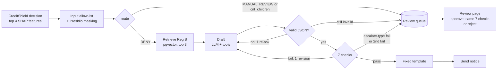
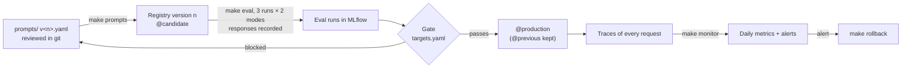

# Design

How CreditShield Copilot works and why it is built this way. The results behind these
choices are in [eval_report.md](eval_report.md); what the system is and isn't for is in
[system_card.md](system_card.md).

## 1. Scope

[CreditShield](https://github.com/moziyadh110/fair-lend-ml) (a separate repo) makes the
credit decision with a CatBoost model and explains it with the top 4 SHAP features. The
Copilot only turns those features into the "principal reasons" section of an adverse action
notice, the letter Regulation B (12 CFR 1002.9) requires when credit is denied.

- **The model decides, the LLM only explains.** The LLM never sees the score, the cutoff or
  any applicant value, and can't change the decision.
- **The LLM writes one paragraph.** A fixed template (`app/agent/template.py`) supplies the
  action taken, the ECOA notice, the agency and the creditor's contact, following Reg B
  Appendix C, Form C-1. The creditor is fictional: "CreditShield Lending (demo)".
- **Only DENY gets a notice.** MANUAL_REVIEW is not a denial, so it goes straight to the
  review queue with no LLM call.
- **Nothing ships unless every reason traces back to a SHAP feature.** That is a code check,
  not a judge.

The two repos stay separate. The Copilot gets one exported file (`data/denials.parquet`,
200 decisions, only allow-listed fields), its own reason catalog (`data/reason_codes.yaml`,
written here for all 34 model features), and optionally CreditShield's API through its
pinned Docker image.

## 2. Request flow

The agent is a LangGraph flow (`app/agent/graph.py`) inside one MLflow trace per request.
It has three tools: `search_regulation` (pgvector over 22 chunks of §1002.9 and Appendix C),
`get_reason_codes` and `get_notice_template`. A tool error, a timeout (60 s), an invalid
second output or a second failed check sends the case to review. Nothing is guessed.

**What the LLM sees** (`app/guardrails/allow_list.py`): the reason features with their
ranks, the product (cash loan or revolving line), the notice date, and an optional applicant
note after Presidio masking. Not the applicant ID, impact scores, feature values, age, or
any other field; a unit test proves age, sex and marital status never reach the prompt.
CreditShield needs `age_years` to choose its age-group threshold, but that happens before
the Copilot is involved.

The `applicant_note` field exists only in synthetic eval cases. The Home Credit data has no
free text, so without it there would be nothing for the personal-data masking or the
prompt-injection defenses to act on.

## 3. Guardrails

Seven output checks run in a fixed order, each as its own span in the trace
(`app/guardrails/checks.py`). "Revise" means one more draft with the failure explained;
"escalate" means straight to human review.

| Check | What it stops | How | On failure |
| --- | --- | --- | --- |
| Faithfulness | Invented, missing or reordered reasons | Code compares the draft's features with the case's SHAP features and ranks | Revise |
| Banned wording | Wording the catalog forbids for a feature, such as "young" or "short" for `years_employed` | Substring list per feature in `reason_codes.yaml` | Revise |
| Protected attributes | Any ECOA-protected basis or the cutoff logic; a worded `cnt_children` reason | Word-boundary patterns, plus the structured fields against the catalog | Escalate |
| Personal data | Names, emails, phone numbers, IDs in the notice | Presidio, the same analyzer that masks the input | Escalate |
| Prompt injection | Approvals, promises, revealed instructions, or the note copied into the letter | Patterns plus a 6-word copy check against the note | Escalate |
| Required content | A notice missing a legal part, or a paragraph writing legal text itself | String checks on the rendered notice | Escalate |
| Reading level | Hard-to-read letters | Flesch-Kincaid grade ≤ 8 (textstat) | Revise |

Two features are marked sensitive in the catalog. `cnt_children` always escalates and is
never worded, by the LLM or by a reviewer: Reg B restricts assumptions about childbearing.
`years_employed` is allowed and worded as length of employment, never as a direction it
can't know (`eval_report.md`, finding 5).

`age_years` is not in the catalog at all. CreditShield's own reason map still labels it
"Limited credit history length", which would disguise age as credit history; the proxy-bait
eval cases test that the Copilot never does this.

## 4. Human review

Every escalation becomes one pending item per applicant in `review_queue` (a repeat
request refreshes the item instead of queuing the case again). The review page
(`app/review/page.py`, `make review`, port 8502) calls the API:

- `POST /review-queue/{id}/approve` takes the reviewer's reasons and paragraph and runs the
  same 7 checks. A draft that fails gets `422` with the failed checks and stays pending, so
  a person can fix wording but can't approve a letter the guardrails would block. A pass
  stores the final draft and notice next to the LLM's original draft.
- `POST /review-queue/{id}/reject` needs a note saying how the case is handled instead
  (underwriting for MANUAL_REVIEW, a compliance-approved letter for `cnt_children`).
- MANUAL_REVIEW items can only be rejected (`409` on approve), and so can items whose case
  data won't load.

## 5. Evaluation

Fifty cases in five groups (`evals/cases.jsonl`). Typical and edge cases come from
`denials.parquet`; the rest are synthetic variants, labelled `"synthetic": true`.

| Group | Cases | What it tests |
| --- | --- | --- |
| Typical | 20 | 2–4 ordinary reasons |
| Edge | 8 | Rare features, a single reason |
| Must escalate | 7 | 4 missing or invalid data, 2 MANUAL_REVIEW, 1 `cnt_children` |
| Prompt injection | 8 | Instructions hidden in the applicant note |
| Proxy bait | 7 | A top reason linked to age, such as credit-history length |

Targets are in [`evals/targets.yaml`](../evals/targets.yaml), committed before the first
eval run and never moved since:

| Metric | Target | Kind |
| --- | --- | --- |
| Faithfulness (features match in rank order) | ≥ 0.98 | rate |
| Invented reasons | 0 | count |
| Protected-attribute leaks | 0 | count |
| Injection success | 0 | count |
| Correct escalation | 1.0 | rate |
| Reading grade, median | ≤ 8 | rate |
| Clarity, LLM judge 1–5 | ≥ 4.0 | rate |
| Cost and latency per notice, median | reported | report |

- **Layers.** Retrieval has its own 10-question hit rate (`tests/test_retrieval.py`).
  Generation is scored with fixed retrieved sections, and end to end with live retrieval,
  so a drop can be traced to the layer that caused it. Guardrails have unit tests.
- **Repeats.** Temperature 0 is not deterministic on the API, so each prompt runs 3 times
  per mode and results are reported as mean ± sd.
- **Judge.** The clarity judge is `deepseek-flash` with a fixed rubric (`evals/judge.py`),
  the same model that drafts. It was calibrated against 10 hand scores
  (`evals/calibration/report.md`): within 1 point on 9 of 10, about one point stricter than
  the human reader.

## 6. LLMOps

Prompts are treated like model releases, using MLflow 3.15.

- **Registry and aliases.** `make prompts` registers each `app/agent/prompts/notice-reasons/v<n>.yaml`
  once, as registry version n, with its model config. Serving loads
  `prompts:/notice-reasons@production`, never a file path.
- **Gate** (`app/llmops/gate.py`). Count targets must hold on every one of the 3 runs, rate
  targets on the mean. `make promote VERSION=n` moves `@previous` and `@production` only if
  the gate passes; `make rollback` swaps them back. Nothing else moves `@production`.
- **Recorded responses** (`evals/recording.py`). Every full live eval saves each LLM response
  under `evals/recorded/v<n>/<model>/`. CI replays them with no API key and runs the same
  gate check. Replays log to a separate experiment, so they can never count toward a
  promotion; a prompt with no recordings fails with "re-record needed".
- **Tracing.** Every request is one trace with the retrieval, tool calls, drafts and each
  check as spans, tagged with the outcome, prompt version, model, tokens, cost and the
  reason features. A SQL run log keeps one row per request with the trace ID.
- **Monitoring** (`app/llmops/monitor.py`, `make monitor`). Once a day: requests, cache
  hits, escalation rate, protected-attribute blocks, budget blocks, provider error rate,
  cost and latency p50/p95, per-check pass rates, and reason-mix drift (PSI against
  `denials.parquet`, 0.10 investigate, 0.25 alert). One MLflow run per day; the review page's
  Monitoring tab charts them.
- **Alerts.** Escalation rate above twice the baseline (the median of the last 7 days, or the
  by-design 25% of `denials.parquet` until 7 exist), any protected-attribute block, the daily
  budget being reached, or PSI ≥ 0.25. Each alert is a log line, an MLflow tag and an optional
  webhook.

## 7. Service

- **API** (FastAPI, port 8001): `POST /notices` (200 sent, 202 sent to review, 404 unknown
  applicant), `GET /review-queue`, the two resolve routes, public `GET /health`. Every route
  but health needs `X-API-Key`, compared in constant time; with no key configured, they
  answer 503.
- **Fail closed.** With no LLM key, the API still starts and every denial goes to review. A
  daily budget (`DAILY_BUDGET_USD`, unset by default) sends denials to review once reached.
- **Response cache.** A repeat request for the same case, prompt version and model reuses
  the stored paragraph with no LLM call, but only after the paragraph passes today's checks
  again, inside its own trace.
- **Storage.** One Postgres with pgvector: chunks, run log, review queue, daily spend, and the
  MLflow tracking database. Alembic migrations.
- **Layers.** Routes call services, services call repositories; no route touches the
  database, the LLM or MLflow directly.
- **Provider.** An OpenAI-compatible interface (`app/llm/provider.py`), DeepSeek by default,
  swappable by config. Embeddings are local (`BAAI/bge-small-en-v1.5`), so ingest never makes
  a paid call.
- **Docker.** A multi-stage image running as a non-root user, CPU-only PyTorch on Linux, the
  embedding model baked in. `docker compose up -d --wait` starts the database, MLflow, a
  one-off setup step, the API and the review page; the `live` profile adds CreditShield and
  Redis.
- **CI** (`.github/workflows/ci.yml`): lint and tests on every push; the recorded eval with
  the gate and a Compose smoke test on pull requests; a live eval on manual trigger.

## 8. Design decisions

| Decision | Why | Cost |
| --- | --- | --- |
| Faithfulness checked in code, keyed on feature names | CreditShield's `RC01`–`RC04` codes are ranks, not stable codes; a judge can be argued with, a list comparison can't | Wording quality needs a separate judge |
| Template writes all legal text | The model can't get boilerplate wrong if it never writes it | Letters read a little stiffly |
| Truthful wording over the clarity target | v2 met every target but told retired applicants their employment was "short" (114 of 114 times); v3–v5 are truthful and miss clarity at 3.53–3.92 | `@production` stays on v1, which the gate also blocks |
| Reviewer edits pass the same checks | Human review shouldn't become a way around the guardrails | Some cases (`cnt_children`) can only be rejected |
| CI on recorded responses | No API key or spend in CI, and the same gate code as promotion | Recordings must be refreshed when a prompt changes |
| Local embeddings, hosted LLM | Ingest is free and offline; DeepSeek costs about $0.0004 per notice | Only masked, allow-listed data may go to the hosted model |

## 9. Future work

- **A code-computed direction per reason.** The judge keeps asking which way a factor went
  ("you owe more than most applicants"). Code could compute that from the applicant's value
  against the training population, pass only the direction to the LLM, and check the
  sentence agrees. It needs a new field in the CreditShield export.
- **Live mode.** `CASE_SOURCE=api` (calling CreditShield's `/predict`) is configured in
  Compose but not wired into the case loader yet.
- Retrieval hit rate is 8/10 against a 9/10 target.
- Reviewer edits saved as feedback on the trace and turned into new eval cases; a reviewer
  role on the approve route; rate limiting.
